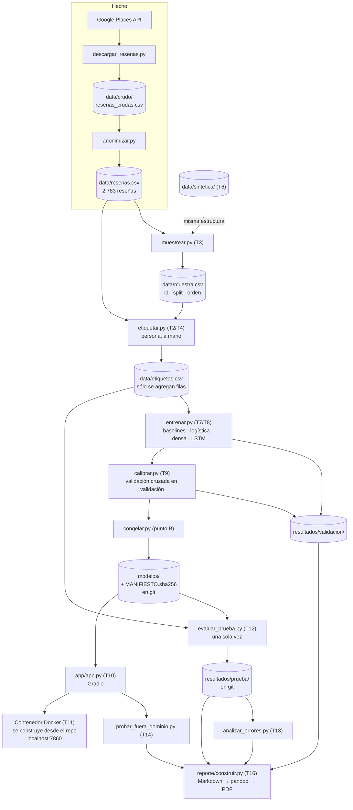

# Arquitectura — clasificador de reseñas "¿hay que atenderla?"

Estado: **aprobada el 23-nov-2026** (punto de control 0 de [PLAN.md](PLAN.md)). Nada de esto está implementado todavía, salvo la descarga y la anonimización.

Fuentes: [INSTRUCCIONES.md](INSTRUCCIONES.md) (requisitos), [DECISIONES.md](DECISIONES.md) (D1–D11, decisiones de datos y etiquetado). Aquí se agregan las decisiones técnicas como ADR-01 a ADR-09.

## 1. Requisitos

### Funcionales

| # | Requisito | Origen |
|---|---|---|
| F1 | Etiquetar a mano 700 reseñas, guardando quién, cuándo y cuánto tardó cada una | §2, D4, D6 |
| F2 | Muestrear y separar en entrenamiento / validación / prueba por fecha, sin restaurantes repetidos entre splits | §2, D3–D5 |
| F3 | Entrenar desde cero un clasificador TF-IDF + capas densas, y una LSTM con embeddings propios como alternativa | §1 |
| F4 | Comparar con tres baselines triviales, con métrica y costo | §4 |
| F5 | Elegir el umbral que minimiza el costo esperado; reportar el costo por 1000 casos | §4, D2 |
| F6 | Calibrar las probabilidades (curva de fiabilidad, ECE) y medir el efecto en el costo | §4 |
| F7 | Correr el modelo congelado **una sola vez** sobre prueba | §2, §6 |
| F8 | App: recibe el texto de una reseña y devuelve clase, probabilidad y umbral, o "fuera de dominio" con su razón | §3 |
| F9 | Análisis de 20 errores y de 10 entradas fuera de dominio | §4, D8, D9 |
| F10 | Reproducir todo con una muestra sintética, sin las reseñas reales | §2 |
| F11 | Generar las figuras y tablas del PDF desde los resultados, sin copiar cifras a mano | §5 |

### No funcionales

| Atributo | Meta | Cómo se verifica |
|---|---|---|
| Latencia | < 2 s por caso; meta interna p95 < 200 ms con el modelo ya cargado | Prueba automatizada con 100 casos (T10) |
| Robustez | Ninguna entrada tumba la app | Prueba con entradas raras (vacío, emoji, 10,000 caracteres, HTML, números, otro idioma) |
| Cómputo | < 20 min en total, en CPU (Mac) | Cada script anota su tiempo en `resultados/tiempos.json` |
| Reproducibilidad | Mismo resultado con la misma semilla; un comando por etapa; corre completo con la muestra sintética | T6 y prueba de punta a punta |
| Integridad | Sin LLM ni modelos preentrenados en el clasificador, el filtro ni el etiquetado; prueba usada una vez | ADR-02, ADR-05, ADR-07 |
| Privacidad | Ninguna reseña real en git, en la imagen de la app ni en los logs; sin datos personales | `.gitignore`, ADR-08, D10 |
| Costo | $0 | Todo corre en la máquina de quien la usa; no hay servicios en la nube |
| Instalación | Otra persona la instala y la usa sin ayuda, siguiendo el README: instalar Docker Desktop, conseguir el repo, un comando o doble clic | Prueba en un clon limpio (T11) |
| Arranque | La app responde a los ≤ 30 s de arrancar el contenedor ya construido | Se mide en T11 |

### Fuera de alcance

Hosting en la nube, inicio de sesión, varias reseñas a la vez, reentrenar desde la app, otros idiomas, monitoreo en producción.

## 2. Vista general

El patrón es una **tubería por lotes de scripts** que se pasan archivos (cada etapa lee archivos y escribe archivos), más **un paquete compartido** (`src/resenas/`) con todo lo que se usa en más de un lugar. El punto clave es que el entrenamiento, la evaluación y la app usan **el mismo código** de limpieza de texto, predicción, calibración y filtro de fuera de dominio: así lo que se evalúa es exactamente lo que corre en la app.



### Paquete compartido `src/resenas/`

| Módulo | Responsabilidad | Lo usan |
|---|---|---|
| `config.py` | Rutas, semilla, fechas de corte, costos (FP = 3, FN = 30), tamaños de muestra. Un solo lugar para cada número. | Todos |
| `muestreo.py` | Muestra y split (D3–D5, D7) y su verificación. | muestrear.py, pruebas |
| `etiquetado.py` | Qué reseña sigue (orden, reservas), progreso, registro de `etiquetas.csv` y lista del repaso (T5). | etiquetar.py, pruebas |
| `privacidad.py` | Reemplazo de nombres anotados a mano (D10, D23). | anonimizar.py, revisar_nombres.py |
| `datos.py` | Cargar y validar CSV (columnas, tipos). `cargar_split("prueba")` falla si no se llama desde `evaluar_prueba.py`. | Scripts |
| `texto.py` | Limpieza: minúsculas, URL → `<url>`, números → `<num>`, recorte a 5,000 caracteres. Conserva acentos y signos. | Entrenamiento y app |
| `modelos.py` | Red densa sobre TF-IDF y LSTM, en PyTorch; entrenar, guardar y cargar. | Entrenamiento y congelado |
| `decision.py` | Costo esperado, barrido de umbral, costo por 1000. | Validación y prueba |
| `calibracion.py` | Platt e isotónica; validación cruzada dentro de validación. | Calibración y app |
| `metricas.py` | Acuerdo y κ (T5) ✔; matriz de confusión, ECE, curva de fiabilidad, intervalos por bootstrap. | T5, validación y prueba |
| `fuera_dominio.py` | Filtro propio de entradas fuera de dominio (ADR-05). | App y T14 |
| `predictor.py` | Carga los artefactos una vez; `predecir(texto) → Resultado` (clase, probabilidad, umbral, fuera de dominio, razón, ms). | App, prueba, T13, T14 |

### Estructura del repositorio

```
src/resenas/            paquete compartido (arriba)
scripts/                una etapa por script, cada uno con --help y --sintetica
  descargar_resenas.py  ✔ hecho
  anonimizar.py         ✔ hecho
  muestrear.py          T3 ✔
  etiquetar.py          T2 ✔
  generar_sintetica.py  T6 ✔ (D20)
  auditar_seguridad.py  antes de cada commit (D21)
  entrenar.py           T7, T8   (--modelo mayoritaria|todo|estrellas|logistica|densa|lstm)
  calibrar.py           T9
  congelar.py           punto B
  evaluar_prueba.py     T12
  analizar_errores.py   T13
  probar_fuera_dominio.py T14
app/app.py              T10  (Gradio)
Dockerfile              T11  imagen de la app (sólo src/, app/, modelos/)
compose.yaml            T11  `docker compose up --build`
.dockerignore           T11  excluye data/, cache/, .env, resultados/
iniciar.command         T11  doble clic en Mac
iniciar.bat             T11  doble clic en Windows
tests/                  pytest
modelos/                en git a partir del punto B (ADR-06)
resultados/validacion/  tablas (.md / .csv / .json) y figuras (.png)
resultados/prueba/      sólo los escribe evaluar_prueba.py; en git
reporte/                reporte.md, construir.py, reporte.pdf
data/                   ignorado por git (salvo data/sintetica/: resenas, muestra, muestra_prueba, etiquetas)
```

### Contratos de datos

| Archivo | Columnas | Quién escribe | Quién lee |
|---|---|---|---|
| `data/resenas.csv` | `id, lugar, consulta, tipo_lugar, rating_lugar, fecha, estrellas, idioma, texto` | anonimizar.py | todos |
| `data/muestra.csv` | `id, split, estrato, orden, reserva, semilla` (entrenamiento y validación) | muestrear.py | etiquetar.py, entrenar.py |
| `data/muestra_prueba.csv` | mismas columnas, sólo prueba; SHA-256 en D17 | muestrear.py | etiquetar.py, evaluar_prueba.py |
| `data/etiquetas.csv` | `id, etiqueta (1/0/vacía), ambigua, nombre_escapado, segundos, etiquetadora, marca_tiempo, version_guia` | etiquetar.py (sólo agrega filas) | entrenar.py, evaluar_prueba.py |
| `modelos/config.json` | `umbral, calibrador, version, semilla, hash_prueba, fecha` | congelar.py | predictor.py |
| `modelos/MANIFIESTO.sha256` | SHA-256 de cada artefacto | congelar.py | evaluar_prueba.py, app |

En la muestra, `orden` recorre primero las principales (`reserva = False`) y después las reservas. Por cada ambigua, `etiquetar.py` toma la siguiente reserva del mismo split y estrato (D7, D17).

Que `etiquetas.csv` sólo reciba filas nuevas hace que un corte de luz no pierda más de una etiqueta, y que se pueda reconstruir el tiempo total de etiquetado. Si una reseña se etiqueta dos veces, vale la última fila (y así se mide la consistencia en T5).

## 3. Decisiones (ADR)

### ADR-01: Tubería de scripts con un paquete compartido

**Estado:** aceptado (punto de control 0, 23-nov).

**Contexto.** Hay que entregar en 7 días; las etapas se corren pocas veces y en orden; la prueba se tiene que tocar una sola vez; la app tiene que hacer lo mismo que se evaluó.

**Decisión.** Un script por etapa que lee y escribe archivos con contrato fijo, más `src/resenas/` para el código común. Nada de notebooks como fuente de verdad: las figuras salen de scripts.

**Alternativas.**
- *Un notebook por fase:* rápido para explorar, pero se ejecuta fuera de orden, mezcla validación y prueba con facilidad y no se puede probar con pytest. Se puede usar un notebook sólo para explorar, sin que produzca resultados.
- *Herramienta de orquestación (DVC, Make, Prefect):* reproducibilidad automática, pero es una herramienta más que aprender por 8 etapas. Basta con documentar el orden en el README.

**Consecuencias.** (+) Lo que corre la app es lo que se evaluó; cada etapa se prueba sola; corre con la muestra sintética cambiando un parámetro. (−) Más archivos que un notebook; hay que cuidar que los contratos no cambien a medio camino.

### ADR-02: Modelo — TF-IDF + red densa en PyTorch; LSTM como alternativa

**Estado:** aceptado (framework elegido el 23-nov).

**Contexto.** El enunciado pide clasificador entrenado desde cero con BoW/TF-IDF y capas densas, o embeddings propios con LSTM. La validación tiene sólo ~200 casos; el entrenamiento, 300 con sobremuestreo.

**Decisión.**
- Entrada: TF-IDF de scikit-learn con palabras (1–2) y caracteres (3–5). Los n-gramas de caracteres ayudan con las faltas de ortografía. Vocabulario sólo del entrenamiento.
- Red: TF-IDF → 1 capa oculta (32–128 ReLU, dropout) → 1 salida sigmoide; PyTorch, CPU, semilla fija.
- Hiperparámetros: rejilla chica (≤ 8 combinaciones) elegida con validación cruzada de 5 partes **dentro de entrenamiento**, por ROC-AUC (no depende de la proporción de clases). Validación queda para comparar modelos, calibrar y elegir el umbral.
- Alternativa obligatoria (T8): LSTM de una capa con embeddings propios (dimensión 64, 200 tokens máximo), mismo framework.
- Referencia: regresión logística sobre el mismo TF-IDF. **No es el modelo entregado.**

**Alternativas.**
- *Keras/TensorFlow:* más corto de escribir, pero la instalación en Mac ARM es más frágil y pesa más en la app.
- *MLP de scikit-learn:* app más ligera (sin torch), pero dos estilos de código para las dos redes.
- *Embeddings preentrenados (fastText, word2vec):* prohibidos (§1: "embeddings propios").

**Consecuencias.** (+) Un solo framework para las dos redes; control de semillas. (−) torch hace más pesada la imagen de Docker y más lenta su construcción (ver ADR-08).

### ADR-03: Calibración con datos de prevalencia real

**Estado:** aceptado (punto de control 0, 23-nov).

**Contexto.** El entrenamiento tiene ~50 % de reseñas de 1–3★ (D4) y el uso real ~25 %, así que el modelo sale descalibrado de origen. Validación (aleatoria) tiene la prevalencia real, pero sólo ~200 casos y ~45 positivos, y también se usa para el umbral.

**Decisión.**
1. Validación cruzada de 5 partes dentro de validación: en cada parte se ajusta el calibrador con 4/5 y se aplica a 1/5. Resultado: probabilidades calibradas "fuera de la parte" para las 200.
2. Con ellas: curva de fiabilidad, ECE (10 contenedores) y barrido de umbral.
3. Se comparan Platt e isotónica; se espera que gane Platt (con ~45 positivos la isotónica sobreajusta), pero se decide por cifra.
4. El calibrador final se ajusta con las 200 y se congela.
5. Se responde "¿decidir u ordenar?" comparando el umbral elegido con el teórico 3 / 33 ≈ 0.09 y viendo el ECE.

**Alternativas.**
- *Calibrar con predicciones fuera de partición del entrenamiento:* prevalencia equivocada (50 % y no 25 %).
- *Corrección analítica del prior (ajuste del logit):* supone que se sobremuestreó por clase, pero se sobremuestreó por estrellas, que no son la etiqueta.
- *Sin calibrar y sólo ordenar:* el enunciado pide corregir y medir el efecto.

**Consecuencias.** (+) Probabilidades con la proporción real; umbral y calibración sin usar prueba. (−) Con 200 casos el ECE es ruidoso: se reporta con intervalo por bootstrap.

### ADR-04: Umbral por costo esperado

**Estado:** aceptado (costos en D2).

**Decisión.** Costo por 1000 = 1000 × (FP × 3 + FN × 30) / n, en minutos. Barrido de 0.01 a 0.99 cada 0.01 sobre las probabilidades calibradas de validación; se elige el umbral de menor costo (si hay empate, el más alto, que manda menos reseñas al gerente). Los tres baselines se reportan igual: "nada es atender", "todo es atender" y "≤ 2★ = atender". Análisis de sensibilidad con proporción 20:1.

**Alternativas.** Umbral 0.5 o por F1: la rúbrica los califica con 6 como máximo.

### ADR-05: Filtro de fuera de dominio propio, sin modelos preentrenados

**Estado:** aceptado (punto de control 0, 23-nov).

**Contexto.** La app no se debe caer y tiene que responder algo sensato ante entradas que no son reseñas en español. Un detector de idioma preentrenado podría leerse como "clasificador preentrenado".

**Decisión.** Reglas en orden; la primera que se cumple rechaza y da su razón:

| Regla | Rechaza si |
|---|---|
| Vacía | No hay texto después de limpiar |
| Muy corta | Menos de 3 palabras |
| No parece español | Menos del X % de las palabras están en una lista propia de palabras comunes del español (sacada del corpus de entrenamiento) |
| Vocabulario desconocido | Menos del Y % de las palabras están en el vocabulario del TF-IDF |
| Larga | Más de 5,000 caracteres: **no rechaza**, se recorta y se avisa |

X y Y se fijan con las reseñas de entrenamiento (por ejemplo, el percentil 1). No se usa prueba. Lo que pasa el filtro se clasifica de forma normal. El filtro no detecta reseñas en español de algo que no es un restaurante (un hotel, un producto): es un límite que se documenta en T14 y en el PDF.

**Alternativas.**
- *Detector de idioma (langdetect, fastText):* más preciso, pero preentrenado. Riesgo de integridad.
- *Rechazar por probabilidad baja:* una red no da probabilidades bajas a lo desconocido; da cualquier cosa.
- *Detector de novedad (autoencoder, densidad):* demasiado para 7 días.

### ADR-06: Modelo congelado y candado de la prueba

**Estado:** aceptado (versionar el modelo, 23-nov).

**Decisión.**
- `congelar.py` copia a `modelos/` el vectorizador, la red, el calibrador y `config.json` (umbral, semilla, hash del archivo de prueba), escribe `MANIFIESTO.sha256`, y se hace commit. Se quita `modelos/` del `.gitignore`. Pesa unos pocos MB: el vocabulario son palabras y n-gramas sueltos, no reseñas.
- `evaluar_prueba.py` se niega a correr si:
  - algún hash no coincide con el manifiesto,
  - hay cambios sin commit en `src/` o `modelos/`,
  - ya existe `resultados/prueba/`.
- Escribe resultados con la fecha y el commit, y se hace commit de inmediato.
- Si después aparece un error: no se borra nada. Se agrega `resultados/prueba_corregida/` y una entrada en `DECISIONES.md` que diga qué se corrigió; en el PDF se reportan las dos cifras.

**Alternativas.** Sólo manifiesto de hashes (el modelo queda sin respaldo en el repo); confiar en la disciplina (no deja evidencia).

### ADR-07: Interfaz con Gradio

**Estado:** aceptado (23-nov).

**Decisión.**
- `app/app.py` con Gradio. Carga `predictor` una vez al arrancar. Una caja de texto, botón y ejemplos.
- Muestra: clase en palabras ("Atender" / "No hace falta"), probabilidad calibrada, umbral aplicado, una barra que compara las dos, tiempo de respuesta, y si se rechaza, "Fuera de dominio" y la razón.
- Escucha en `0.0.0.0:7860` para funcionar dentro del contenedor (ADR-08). Para desarrollo también corre sin Docker (`uv run python app/app.py`).
- No guarda ni registra lo que se escribe.

**Alternativas.**
- *Streamlit:* reejecuta todo el script en cada interacción y tiene más trucos de caché para cargar el modelo una vez.
- *FastAPI + HTML propio:* más código, ninguna ventaja aquí.

### ADR-08: Distribución — contenedor Docker que se construye desde el repo

**Estado:** aceptado (23-nov).

**Contexto.** §3: quien la usa no programa ni reentrena nada, y alguien de tu trabajo la tiene que poder usar sin ti. §6: lo que sólo funciona en tu máquina no se puede verificar. El repo de GitHub es privado. Tu Mac es ARM; quien la pruebe puede tener Intel o Windows.

**Decisión.**
- **Imagen:** `Dockerfile` en la raíz, sobre `python:3.12-slim`. Instala dependencias con `uv sync --frozen` usando el índice **CPU** de PyTorch: sin él, en Linux se baja torch con CUDA (varios GB). Copia sólo `src/`, `app/`, `modelos/`, `pyproject.toml` y `uv.lock`. Corre sin root.
- **`.dockerignore`:** excluye `data/`, `cache/`, `.env`, `resultados/`, `.venv/` y `.git/`. Así ninguna reseña real ni la key de Places entran a la imagen aunque estén en el disco.
- **`compose.yaml`:** un servicio, puerto `7860:7860`, `restart: unless-stopped` y un healthcheck que pide la página.
- **Lanzadores:** `iniciar.command` (Mac) y `iniciar.bat` (Windows). Revisan que Docker esté corriendo, ejecutan `docker compose up --build -d`, esperan el healthcheck y abren `http://localhost:7860`. Si algo falla, dicen qué hacer en español.
- **Se construye en la máquina de quien la usa:** no hay que publicar imágenes ni preocuparse por ARM o Intel.
- **README, sección "Instalar y usar la app":** pasos numerados para alguien que no programa:
  1. Instalar Docker Desktop (con capturas). En Windows, aceptar WSL2.
  2. Conseguir el repo: descargar el ZIP que se le compartió, o clonarlo si se le dio acceso.
  3. Doble clic en el lanzador, o `docker compose up --build`.
  4. Esperar la primera construcción (~3–5 min) y usar la app.
  5. Cómo apagarla.
  6. Qué hacer si falla.
- **Tamaño:** se mide al construir. Si la imagen pasa de ~1.5 GB o el arranque de 30 s, se exportan los pesos de la red densa a numpy para que la app no cargue torch, con una prueba que confirme que da exactamente la misma salida.

**Alternativas.**
- *Imagen pública en GitHub Container Registry:* no hay que construir, pero queda pública y hay que publicar versiones para ARM e Intel.
- *Archivo .tar por Drive:* sin nada público, pero pesa ~1 GB y hay que regenerarlo con cada cambio.
- *Cloud Run con login de Google:* liga sin instalar nada, pero hay que verificar el acceso de cuentas externas y el arranque en frío, y tiene costo de configuración. Descartado el 23-nov.
- *Hugging Face Spaces o la liga temporal de Gradio:* sin control de acceso, o dependiente de que tu Mac esté prendida.
- *Ejecutable de escritorio (PyInstaller):* con torch pesa mucho y hay que compilar uno por sistema operativo.

**Consecuencias.** (+) Funciona igual en cualquier máquina con Docker; las instrucciones se prueban en un clon limpio. (−) Quien la usa tiene que instalar Docker Desktop (~10 min la primera vez) y tener acceso al repo o al ZIP; la primera construcción tarda.

### ADR-09: Reporte en Markdown → PDF con pandoc

**Estado:** aceptado (23-nov).

**Decisión.**
- `reporte/reporte.md` con marcadores como `{{costo_prueba}}` y `{{tabla_baselines}}`. `reporte/construir.py` los reemplaza con los valores de `resultados/` y llama a pandoc.
- Motor de PDF: typst (un solo binario, sin instalar LaTeX); xelatex si ya está instalado.
- Figuras en PNG generadas por los scripts.
- La meta de 6–8 páginas se revisa en cada compilación.

**Alternativas.** LaTeX (más control, más instalación); Google Docs (cifras copiadas a mano).

## 4. Tecnología

| Pieza | Elección | Para qué |
|---|---|---|
| Python 3.12 + uv | Ya en uso | Entorno y `uv.lock` |
| pandas | Ya en uso | Datos |
| spaCy `es_core_news_sm` | Ya en uso | **Sólo** anonimización, nunca en el clasificador ni en la app |
| scikit-learn | Nueva | TF-IDF, regresión logística (referencia), Platt e isotónica, métricas |
| torch (CPU) | Nueva | Red densa y LSTM |
| gradio | Nueva | App |
| matplotlib | Nueva | Figuras |
| pytest | Nueva (desarrollo) | Pruebas |
| pandoc + typst | Nuevas (sistema, brew) | PDF |
| Docker + Docker Compose | Ya instalado (Docker 29.6) | Imagen de la app y lanzadores |

Se agregan a `pyproject.toml` cuando empiece la implementación; no antes.

## 5. Pruebas

| Prueba | Qué verifica | Tarea |
|---|---|---|
| `test_decision.py` | Costo por 1000 con casos calculados a mano; el barrido elige el mínimo | T7 |
| `test_metricas.py` | ECE = 0 con probabilidades perfectas; casos conocidos | T9 |
| `test_split.py` | Ningún `lugar` en dos splits; fechas dentro de su periodo; conteos de D4 | T3 |
| `test_fuera_dominio.py` | Cada regla con su ejemplo; nunca lanza excepción | T10 |
| `test_predictor.py` | Entradas raras sin excepción; p95 < 200 ms con el modelo cargado | T10 |
| `test_candado.py` | `evaluar_prueba.py` se niega con un hash distinto o con resultados ya existentes | T12 |
| Instalación limpia | En un clon nuevo, `docker compose up --build` construye, el healthcheck pasa y una reseña de ejemplo da resultado en < 2 s; la imagen no contiene `data/` ni `.env` (`docker run … ls`) | T11 |
| Punta a punta | Toda la tubería corre con `data/sintetica/` | T6 |

## 6. Riesgos

| Riesgo | Efecto | Mitigación |
|---|---|---|
| Pocas quejas en validación o prueba (< 30) | Umbral y ECE inestables | Revisar al cerrar T4; si pasa, anotar en `DECISIONES.md` y reportar intervalos |
| Diferencias entre entrenamiento y app (limpieza distinta) | La app no hace lo que se evaluó | `texto.py` y `predictor.py` compartidos; T12 usa `predictor` |
| Mirar la prueba sin querer | Criterio 2 baja a 4 | `cargar_split("prueba")` bloqueado; candado de ADR-06 |
| Etiquetado más lento de lo previsto | Punto A se retrasa | Orden prueba → validación → entrenamiento; mínimo 500 |
| La red densa no le gana a "todo es atender" | Hay que reportarlo así | Es un resultado válido; el PDF lo explica con cifras |
| torch con CUDA en la imagen | Imagen de varios GB, construcción lenta | Índice CPU de PyTorch en `pyproject.toml`; se mide el tamaño |
| Quien la prueba no logra instalar Docker (Windows sin WSL2, permisos de admin) | T11 falla | README con pasos y capturas; probar antes con una persona; plan B: la usa en tu Mac sin que estés |
| Una reseña real o la key se cuelan en la imagen | Problema de privacidad y de términos de Google | `.dockerignore` + prueba de instalación limpia que lo revisa |
| Datos personales que se escaparon | Problema de privacidad | D10: marcar al etiquetar; la muestra sintética es inventada |
| Cambian las fechas o el texto en una nueva descarga | Split distinto | No se vuelve a descargar (D1) |

## 7. Qué tarea toca qué componente

| Tarea | Componentes | Produce |
|---|---|---|
| T2 | `etiquetar.py`, `etiquetado.py` | `data/etiquetas.csv` |
| T3 | `muestrear.py`, `config.py`, `datos.py`, `muestreo.py` | `data/muestra.csv`, `data/muestra_prueba.csv`, hashes (D17) |
| T6 | `generar_sintetica.py` | `data/sintetica/` |
| T7 | `entrenar.py`, `modelos.py`, `decision.py`, `metricas.py`, `texto.py` | `resultados/validacion/` |
| T8 | `modelos.py` (LSTM) | `resultados/validacion/lstm_*` |
| T9 | `calibrar.py`, `calibracion.py` | figura de fiabilidad, ECE, costo antes/después |
| Punto B | `congelar.py` | `modelos/`, `MANIFIESTO.sha256` |
| T10 | `app/app.py`, `predictor.py`, `fuera_dominio.py` | app local |
| T11 | `Dockerfile`, `compose.yaml`, `.dockerignore`, lanzadores, README | app instalable; prueba con otra persona |
| T12 | `evaluar_prueba.py` | `resultados/prueba/` |
| T13 | `analizar_errores.py` | tabla de 20 errores |
| T14 | `probar_fuera_dominio.py` | tabla de 10 entradas |
| T16 | `reporte/` | `reporte.pdf` |
